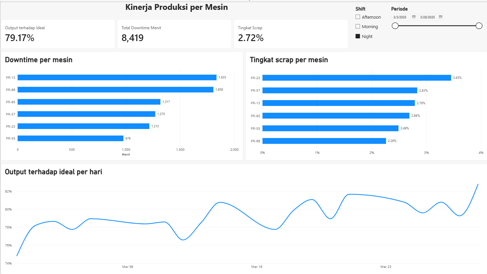

# Manufacturing Operational Performance Analysis

Proyek ini menganalisis kinerja produksi enam mesin pada tiga shift selama
3–28 Maret 2025. Saya menggunakan Python dan Pandas untuk mengolah data,
lalu membangun dashboard Power BI untuk membantu menentukan mesin yang
perlu diperiksa lebih dulu berdasarkan downtime dan tingkat scrap.

## Dashboard

Dashboard Power BI ini bisa difilter berdasarkan shift dan periode.
Tampilan berikut mencakup semua shift pada 3–28 Maret 2025.

**Ringkasan kinerja produksi**

- **82,36% output terhadap ideal** — total unit aktual dibagi total unit ideal selama mesin berjalan.
- **26.668 menit downtime** — total waktu mesin berhenti selama periode analisis.
- **3,11% tingkat scrap** — total unit scrap dibagi total unit produksi.

## Dataset dan proses analisis

Data berasal dari [Manufacturing OEE Dataset](https://databasesample.com/datasets/manufacturing-oee-dataset-output-and-downtime),
dataset simulasi berlisensi CC0 1.0. Analisis menggunakan 360 catatan
produksi dari `shift_runs.csv`, dengan `machines.csv` dan `shifts.csv`
sebagai referensi mesin dan shift.

1. `01_data_understanding.ipynb` — memeriksa struktur dan isi data mentah.
2. `02_data_cleaning.ipynb` — menggabungkan data berdasarkan ID, memeriksa
   duplikat dan nilai kosong, lalu mengekspor data olahan.
3. `03_eda.ipynb` — menghitung KPI dan membandingkan hasil antar mesin.
4. `dashboard/manufacturing-oee.pbix` — menyajikan KPI, peringkat mesin,
   dan tren harian dengan filter shift dan periode.

## Temuan dan tindak lanjut

- **PR-13 menjadi prioritas peninjauan downtime.** Mesin ini mencatat
  downtime tertinggi, sekitar 5,8 ribu menit pada periode analisis.
  Pemeriksaan dapat dimulai dari rincian kategori downtime dan shift
  yang menyumbang menit berhenti paling banyak.
- **PR-95 memiliki tingkat scrap tertinggi untuk semua shift**, yaitu
  3,71% atau 0,60 poin persentase di atas angka keseluruhan sebesar 3,11%.
- **Prioritas scrap berubah ketika analisis difokuskan pada shift malam.**
  Pada shift Night, PR-23 berada di urutan pertama dengan tingkat scrap
  3,45%. Karena itu, PR-23 menjadi prioritas pemeriksaan kualitas jika
  peninjauan hanya mencakup shift malam.

## Validasi dan batasan

Ketiga KPI Power BI dicocokkan dengan hasil Pandas pada tampilan seluruh
data. Filter diuji dengan memilih shift Night, lalu menggeser tanggal awal
dari 3 ke 4 Maret. Total downtime berubah dari 8.419 menjadi 7.994 menit
dan cocok dengan jumlah downtime pada grafik per mesin.

Dataset ini bersifat simulasi. Hasil analisis menunjukkan prioritas
pemeriksaan dalam studi kasus ini. Penentuan penyebab downtime atau scrap
di pabrik memerlukan catatan operasional tambahan.

## Sumber Data

Proyek ini menggunakan [Manufacturing OEE Dataset: Output and Downtime](https://databasesample.com/datasets/manufacturing-oee-dataset-output-and-downtime) dari Database Sample. Dataset simulasi ini berlisensi [CC0 1.0](https://creativecommons.org/publicdomain/zero/1.0/) dan mencakup 360 catatan produksi dari 6 mesin dan 3 shift selama 20 hari kerja pada 3–28 Maret 2025.

Tiga file CSV yang digunakan dalam analisis:

- `shift_runs.csv` — catatan produksi, downtime, dan scrap per mesin dan shift.
- `machines.csv` — referensi kode mesin dan lini produksi.
- `shifts.csv` — referensi nama shift serta tanggal dan waktu mulai shift.